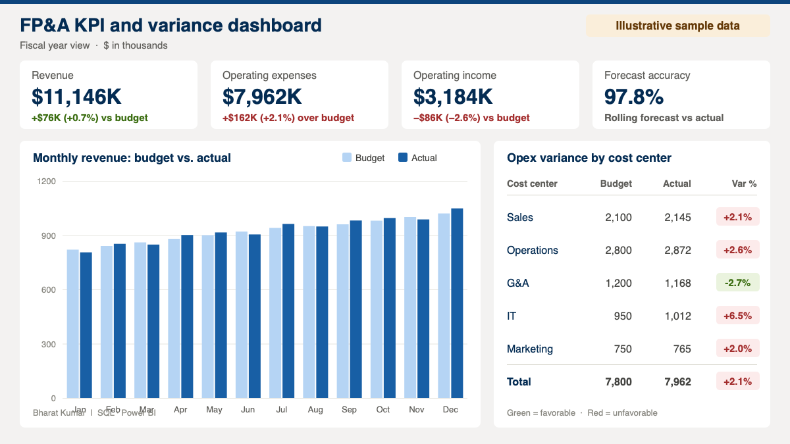

# Financial Analytics Portfolio — Bharat Kumar

Financial Analyst | FP&A, Budgeting & Forecasting, Financial Modeling
MBA, Concordia University Chicago (2026) · [LinkedIn](https://www.linkedin.com/in/bharat-kumar-7b926228a)

## Projects

### 1. AI-Powered Analytics Pipeline (MBA Capstone)
**Tools:** Python, LLMs
- Automated data screening, validation, and KPI reporting with auditable outputs
- Cut data processing time by 50%
- See the full project: [HireSmart AI capstone](https://github.com/bharat522464-ai/AI-Powered-Analytics-Pipeline-MBA-CAPSTONE-Project)

### 2. Customer Profitability, Pricing & Cost Model
**Tools:** Excel (SUMIFS, INDEX/MATCH, data validation)
- 6-tab model with 330+ formulas covering 5 customers and 6 products
- Customer P&L ranking accounts by contribution margin against a 15% target
- Pricing tool solving for required and floor price, with a ±10% sensitivity table

### 3. Budgeting, Forecasting & Variance Model
**Tools:** Excel
- Linked budget, monthly actuals, and rolling forecasts to cost-center variance schedules
- Wrote variance commentary on drivers, risks, and opportunities

### 4. FP&A KPI & Variance Dashboard
**Tools:** SQL, Power BI
- Tracks budget vs. actual, forecast variance, and KPIs for leadership

*Shown with illustrative sample data.*

### 5. Labor Expense, Productivity & Staffing Scenario Analysis
**Tools:** Excel
- Compared the cost impact of alternative staffing scenarios

### 6. SuperStore Financial Performance Analysis
**Tools:** Excel
- Analyzed profitability by region and product category to find key drivers and weak segments
